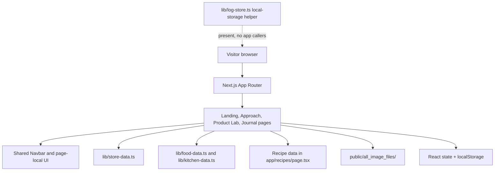
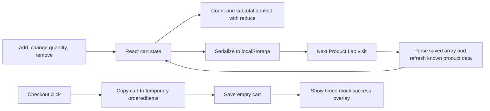

# better4u — Project Blueprint

This guide describes the application currently present in the repository. It is written for someone who has not seen the code before and separates working interface behavior from the product ideas and sample claims shown in that interface.

**Read first:** better4u is a brand and product-experience prototype. The catalog, recipes, ingredient lists, prices, nutrition values and health-related copy are local authored content. The source does not establish that the products exist, that the displayed claims have been validated, or that a business accepts orders.

## 1. Product and user experience

The concept is to make a “better-for-you” alternative feel like a familiar food or drink choice rather than a restrictive health regimen. The pages tell that story, present imagined brands and products, and offer recipe browsing and light planning interactions.

The main experience is:

1. Read the brand story on `/` or `/approach`.
2. Explore the seven concept brand tabs and 31 sample catalog entries in `/product-lab`.
3. Flip eligible product artwork to inspect alternate label imagery, open a larger image, and adjust a browser-local tester cart.
4. Browse one of two recipe collections from `/journal`. The First Batch collection also lets a visitor select recipes into a temporary plate and see a sum of their authored plant-point values.

These actions demonstrate front-end interaction design. The “checkout” control only clears the local cart and opens a short-lived confirmation overlay; no order is transmitted.

## 2. Routes and page responsibilities

| URL | Source | Responsibility and behavior |
|---|---|---|
| `/` | [`app/page.tsx`](app/page.tsx) | Brand landing page; scroll-linked visuals check reduced-motion preference. |
| `/approach` | [`app/approach/page.tsx`](app/approach/page.tsx) | Swap philosophy and concept examples. |
| `/product-lab` | [`app/product-lab/page.tsx`](app/product-lab/page.tsx) | Brand selector, catalog cards, image/label interactions, local cart and mock checkout. |
| `/journal` | [`app/journal/page.tsx`](app/journal/page.tsx) | Journal hub linking to both active collections. |
| `/journal/first-batch` | [`app/journal/first-batch/page.tsx`](app/journal/first-batch/page.tsx) | 21 Indian everyday recipes, filters, recipe selection and points total. |
| `/journal/first-batch/[slug]` | [`app/journal/first-batch/[slug]/page.tsx`](app/journal/first-batch/%5Bslug%5D/page.tsx) | First Batch recipe detail page. |
| `/journal/second-batch` | [`app/journal/second-batch/page.tsx`](app/journal/second-batch/page.tsx) | Search/filter interface for global comfort recipes and a standards tab. |
| `/journal/second-batch/[slug]` | [`app/journal/second-batch/[slug]/page.tsx`](app/journal/second-batch/%5Bslug%5D/page.tsx) | Second Batch item detail route. |
| `/recipes` | [`app/recipes/page.tsx`](app/recipes/page.tsx) | Separate “Phase 3 Draft” recipe hub with 23 entries and modal details; still reachable from Product Lab links. |
| `/vault` | [`app/vault/page.tsx`](app/vault/page.tsx) | Client-side redirect to `/product-lab`; no vault or access gate. |

Next.js App Router maps folders and `page.tsx` files to routes. A folder named `[slug]` denotes a dynamic route segment. The shared [`components/Navbar.tsx`](components/Navbar.tsx) presents three main destinations (Approach, Product Lab and Journal) with a desktop top bar and mobile bottom tabs. The collection and recipe-draft routes are additional routes outside that three-item navigation.

## 3. Architecture at a glance



At runtime, route components import local TypeScript data and render it in the visitor’s browser. Interactive pages use React state; Framer Motion animates transitions. There is no app-specific API route, remote database, product service or account service in this source tree. The [`app/layout.tsx`](app/layout.tsx) provides document metadata, the Geist and Geist Mono font setup, viewport settings and global styles from [`app/globals.css`](app/globals.css).

### Main folders and files

| Path | Role |
|---|---|
| `app/` | App Router route pages and global stylesheet. |
| `components/Navbar.tsx` | Shared primary navigation; route changes are handled by the page callbacks. |
| `lib/store-data.ts` | Typed sample catalog (`MOCK_PRODUCTS`). |
| `lib/food-data.ts` | Kitchen foundations and First Batch recipe-related content. |
| `lib/kitchen-data.ts` | Second Batch introduction and menu item data. |
| `lib/recipes-data.ts` | Additional recipe data module; check actual imports before assuming it powers a visible page. |
| `lib/log-store.ts` | Local-storage helper for weekly plant IDs and dated ferment counts; currently no imports from app pages/components. |
| `lib/config.ts` | Constants including the public diversity target and unused passcode constants. |
| `public/all_image_files/` | Product, recipe and concept media served as static assets. |
| `DESIGN_SYSTEM.md` | Historical design-system specification. |
| `BETTER4U_Content_Audit_Full.md` | Historical copy inventory; not the source of runtime behavior. |

The project scripts and dependency versions are recorded in [`package.json`](package.json); TypeScript strictness and the `@/*` import alias are configured in [`tsconfig.json`](tsconfig.json).

## 4. Product Lab: catalog, interactions and cart

### Catalog model

[`lib/store-data.ts`](lib/store-data.ts) defines a `ProductSKU` type and a `MOCK_PRODUCTS` array. Each product record includes an ID, name, category, descriptive copy, price, image key, colors, optional fiber/culture specifications, sugar/calorie strings, ingredients, a taste description, a proposed swap, and a `brandId`. These fields are display content. No server validates them, calculates nutrition, checks stock or authorizes a purchase.

The Product Lab page separately defines seven concept brand tabs. It filters the catalog by the selected `brandId`, chooses local media paths, and uses local state for the active brand, product selection, label side, image zoom and video controls. Some media paths fall back to shared imagery/video. The exact availability and scientific accuracy of depicted packaging and specifications should not be inferred from their presentation.

### Cart state flow

The cart is page-local React state, serialized into the browser’s `localStorage` key `better4u_lab_cart`. On mount, the page parses any saved JSON and attempts to replace known product snapshots with the current matching catalog record. Add increments a matching product or adds it at quantity one; quantity changes remove an item if its count falls to zero; remove filters it out. Subtotal and item count are calculated from the current state.



This persistence is limited to the current browser profile and can be edited by the user. It is not shared between devices or users. There is no stock check, address collection, payment, order ID, email, server-side order record or fulfillment. The overlay is a presentation state, not proof of purchase.

## 5. Journal and recipe behavior

### Active Journal collections

The [`app/journal/page.tsx`](app/journal/page.tsx) hub links to First Batch and Second Batch. First Batch presents 21 recipes from its route module and supports group and F-GOALS tag filtering. A selected recipe opens a dynamic detail route. A separate “plate” selection remains in that page’s React state while the page is mounted; the visible total is the sum of each selected recipe’s `plantPoints` field. The value is an authored heuristic, not a nutrition analysis. Selection is not written to local storage.

Second Batch reads `MENU_ITEMS` and `KITCHEN_INTRO` from [`lib/kitchen-data.ts`](lib/kitchen-data.ts). Its filtering combines category equality, a case-insensitive name/description search, and all selected badges. Its standards tab presents collection guidance. Recipe detail routes are provided under the `[slug]` directory.

### Separate draft recipe route

[`app/recipes/page.tsx`](app/recipes/page.tsx) contains an independent 23-entry `RECIPES_DATA` array. Its search checks title, tags and ingredients; category/tag chips then narrow the results; selecting a card opens a detail modal with ingredients and steps. The header identifies it as a draft, and Product Lab still links to this route. It is not the same data collection as either Journal batch.

### Plant and ferment helper: present, not wired

[`lib/log-store.ts`](lib/log-store.ts) exports functions to store a set of plant IDs under a week-specific key and a ferment count under a date-specific key. Its hook listens to an in-module listener set so components using the hook can refresh after writes. Source search finds no application caller of this helper; therefore the active recipe page’s plate selection should not be described as a persistent weekly tracker. [`lib/config.ts`](lib/config.ts) declares a public target value of 30, but that constant is also not used by the current pages.

## 6. Visual system and design decisions

The interface uses a warm off-white canvas (`#F7F6F2`), deep teal accent (`#2A7F7F`), restrained borders, rounded cards, spacious layout and editorial typography. Geist Sans/Mono are configured in the root layout. Tailwind utilities and a small global stylesheet carry most presentation; Framer Motion supplies card, modal, navigation and scroll-linked motion; Lucide React supplies icons.

The desktop navigation uses a shared Framer Motion `layoutId` for its active capsule; mobile has a fixed bottom tab bar. The landing page checks `prefers-reduced-motion` for its motion treatments. Do not generalize that support to every route without checking that route’s code.

The retained [`DESIGN_SYSTEM.md`](DESIGN_SYSTEM.md) describes broader intended tokens and principles. Treat that document as a design reference, not a guarantee that every listed rule is implemented on every screen.

## 7. Local setup

1. Install a supported Node.js runtime and npm for the pinned Next.js project.
2. Clone the public repository and enter its root:

   ```bash
   git clone https://github.com/tharungajula2/better4u.git
   cd better4u
   ```

3. Install the lockfile dependencies and start the development server:

   ```bash
   npm install
   npm run dev
   ```

4. Open the localhost URL printed in the terminal. The source does not define app-specific environment variables or require a database service.

Other scripts declared in `package.json` are `npm run build`, `npm run start` and `npm run lint`. There is no `test` script. Build and lint commands are documented for maintainers; runtime validation was not part of this source-only documentation audit.

## 8. Troubleshooting

| Symptom | What to check |
|---|---|
| Dependency install or Next command fails | Confirm Node/npm compatibility with `next@16.2.9`, use the committed `package-lock.json`, then retry `npm install`. |
| Local product or recipe image is missing | Check the literal path under `public/`; static public paths are referenced from the root URL and filenames may contain spaces or punctuation. |
| Cart looks stale or is unexpectedly empty | Inspect or clear this browser’s `localStorage` key `better4u_lab_cart`; data is local and malformed JSON is ignored by the loader’s error handling. |
| Background video does not autoplay | Browser autoplay policy can block playback; use the page’s media controls or inspect the browser console. The code has fallback media paths. |
| A route seems absent from navigation | The shared nav only exposes Approach, Product Lab and Journal. Try the route table directly; `/vault` redirects. |
| `npm run test` is unavailable | No test script is declared in `package.json`. |

Next/font loads Geist fonts through the framework’s font pipeline. If a first build cannot obtain font assets in a restricted/offline environment, check the Next.js font error and network access before changing the font setup.

## 9. Security, privacy and content boundaries

- There is no authentication implementation. The passcode constants in [`lib/config.ts`](lib/config.ts) are unused, and client-side constants would not be a security boundary in any case.
- There is no backend or account storage. Cart state and any use of the standalone log helper are browser-local data.
- The cart is client-controlled. Never rely on its prices, quantities or contents as trusted order input.
- Product ingredients, nutrition figures, probiotic/prebiotic statements and wellness copy are prototype data and have not been independently validated by this code audit. They should not be presented as verified health or product claims.
- The checkout overlay does not accept payment or contact information and must not be represented as a completed transaction.

## 10. Extension paths grounded in the current design

If this concept is intentionally advanced, a practical sequence is:

1. **Content integrity:** distinguish approved product specifications from placeholder copy; model product and recipe records explicitly and validate them.
2. **Accessible interaction:** audit keyboard operation, focus handling, semantic buttons/links, modal focus return and reduced-motion behavior across every route.
3. **Real commerce:** only after business and fulfillment requirements exist, add a server-side catalog/price source, inventory rules, trusted cart validation, payment provider and order lifecycle. Keep secrets on the server and never trust browser local storage.
4. **Real user planning:** decide whether the plant/ferment tracker is a product feature; currently its helper is unused. Specify the data model and privacy/retention behavior before wiring it to a UI or account.
5. **Portfolio quality:** capture current screenshots and link a deployed version only after checking that deployment against this source revision.

These are future options, not claims about existing functionality. For a concise overview, return to the [README](README.md).
